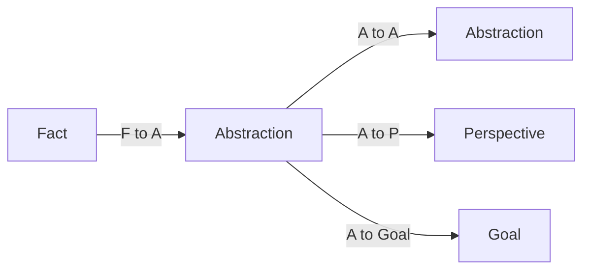

# Concepts
> Status: current

## The four kinds

| Kind | Meaning | Lifecycle |
|---|---|---|
| Fact | An admitted observation | Immutable row; later observations are new admissions |
| Abstraction | A typed, re-derivable pattern | Later `t` may advance its series |
| Perspective | A typed interpretation or stance | Later `t` may advance its series |
| Goal | A desired end-state and its dependencies | Lifecycle transitions append `t`; terminal states have no later transition |

Citation is provenance attached to a Fact or Abstraction. Self is a query over
cue-relevant Perspectives, never a stored entity. Actions and wake behaviour
belong to the host integration; they are not a fifth memory kind.

## Identity and content

A memory series has a stable `handle`. Each admission has a unique `t` (the
row identity). The pair `(handle, t)` identifies a version; a head is a query
projection for the current version, not a replacement for version identity.
Facts remain immutable. Abstractions, Perspectives, and Goals append a later
version on the same handle rather than mutating an old row.

Every memory and Goal version also records `by`, the principal who wrote it,
and `via`, its caller session UUID or `null` for a direct principal call.
The sealed request context supplies this pair. It grants no authority and is
independent of ownership, payload authorship and grounding sources. Reads
return the stored pair; an exact replay retains it, a new version captures its
own writer, and transfer, forget and restore preserve it.

Typed payload is owner-scoped `Content`. Content may be shared by admissions
within its owner and schema, but shared content never collapses two `t` values.
Use the [core rustdoc source](https://github.com/Aquilo-Solution-S/Proxima/tree/main/crates/core/src)
for public types and constructors; use migrations for table shape.

## Layering



Derivation moves upward. A Fact cannot be produced from an Abstraction or
Perspective, and a Perspective cannot be used as the source of a lower-layer
write. An interpretation is a Perspective whose payload references what it
interprets. Similarity is a query result; it does not author a connection.

## Pins

There is no edge table. A pin array stores only target `t` values. The source
array and the write operation determine direction and the closed mechanical
role:

| Pin | Meaning | Stored on |
|---|---|---|
| Origin | What produced this derived row | `memory.origins[]` |
| Reference | What a typed payload points at | `memory.refs[]` or `memory.goal_refs[]` |

The operation determines the pin kind; no public verb writes an edge. Origins
and references are source-owned and rebuildable from node content. A source may
remain visible while an unreadable target is independently redacted. The two
pin kinds use three arrays: `origins[]`, `refs[]`, and `goal_refs[]`.

## Goals

A Goal states what is desired, whose direction it is, its lifecycle state, and
what it depends on. Goal decomposition, evidence, and assignment are fields of
the Goal version, so the Goal owns those references. A lifecycle transition is
an appended `t`; there is no supersession pointer and no in-place mutation.

Scheduling and execution are host decisions. See
[host integration](host-integration.md) for the boundary.

## Citations

`blob_id` is an optional citation on Facts and Abstractions. Perspectives do
not cite. A citation is bibliographic or artefact provenance, not a graph node,
pin, or proof that the cited material is true. Its storage and ownership
contract is part of the data and erasure surface.

## Self

Self is cue-indexed:

```text
situatedSelf(owner, cue) = the owner's head Perspectives that touch cue
```

The query result changes with the owner and cue. It is not a row, an
authorization carrier, a parameterless global projection, or a cached causal
chain.

## Kernel boundary

The Lean kernel states these principles. Code and tests establish runtime
behaviour; they are not inferred from prose. Start with
[Principles.lean](https://github.com/Aquilo-Solution-S/Proxima/blob/main/docs/lean/Causa/Principles.lean),
[Memory.lean](https://github.com/Aquilo-Solution-S/Proxima/blob/main/docs/lean/Causa/Memory.lean),
[Edges.lean](https://github.com/Aquilo-Solution-S/Proxima/blob/main/docs/lean/Causa/Edges.lean),
and [Goals.lean](https://github.com/Aquilo-Solution-S/Proxima/blob/main/docs/lean/Causa/Goals.lean).
