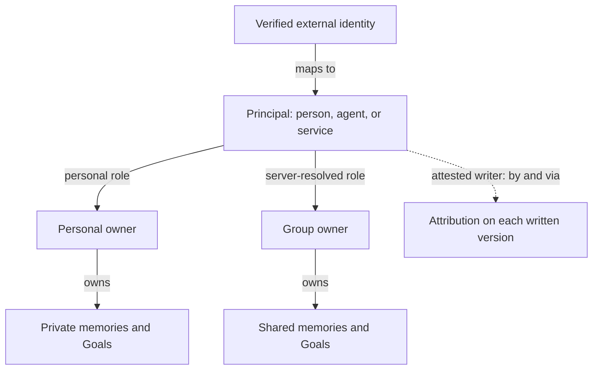
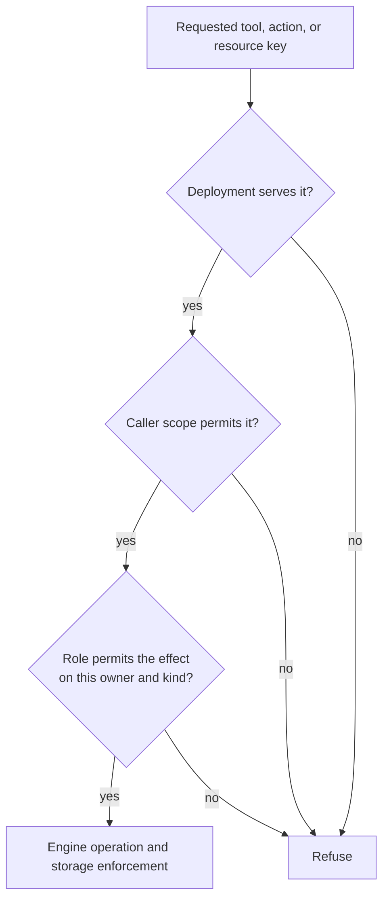
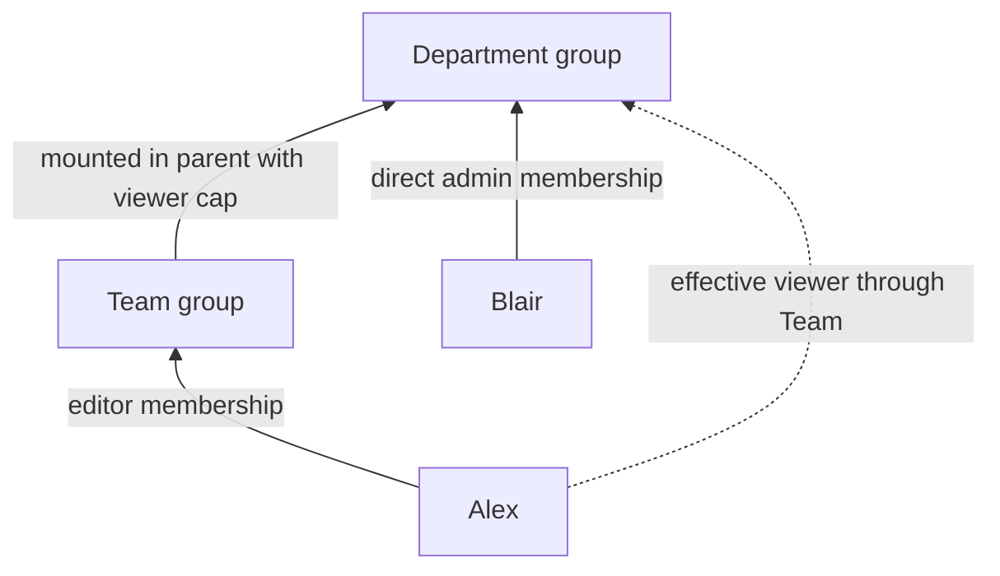
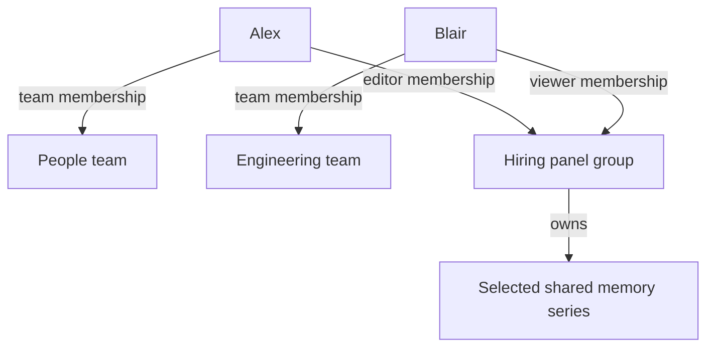
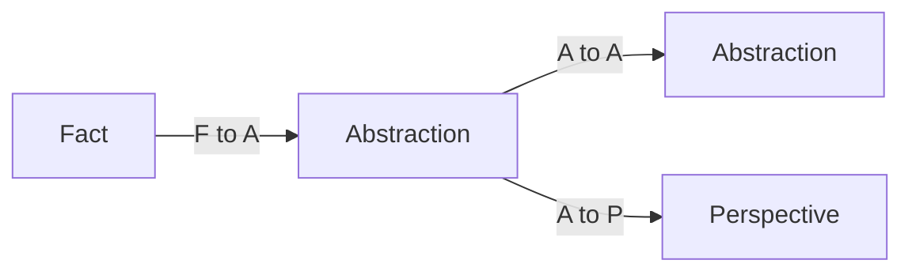
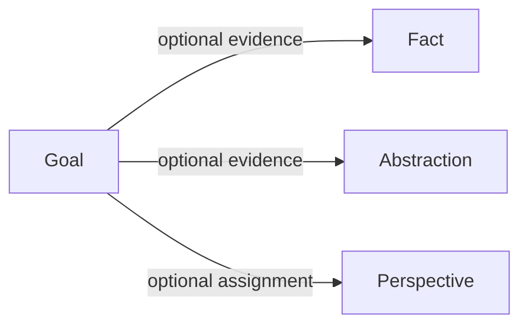

# Concepts
> Status: current

## The four kinds

| Kind | Meaning | Lifecycle |
|---|---|---|
| Fact | An admitted observation | Immutable row; later observations are new admissions |
| Abstraction | A typed, re-derivable pattern | Later `t` may advance its series |
| Perspective | A typed interpretation or stance | Later `t` may advance its series |
| Goal | A desired end-state and its dependencies | Lifecycle transitions append `t`; terminal states have no later transition |

Citation is provenance attached to a Fact or Abstraction. Self is a query over
cue-relevant Perspectives, never a stored entity. Actions and wake behaviour
belong to the host integration; they are not a fifth memory kind.

## Identity and ownership

The target is one explainable access decision: **who is calling, whose data
is involved, and what may this caller do with it?** A person, agent, or service
is a principal. Each memory or Goal has one owner. The principal's role in
that owner determines data access; the request's tool permissions determine
which operations it may invoke.

Start here for the model, follow the
[request flow](host-integration.md#authentication-and-owner-scope) for integration,
and use [Protocol](protocol.md#owner-scope) for transport behaviour. The
[decisions](decisions.md#identity-and-ownership-have-separate-jobs) explain why
these boundaries exist.

### The map



The two owner boxes illustrate separate scopes. A principal may hold roles
in many group owners; each stored entity still belongs to exactly one owner.
Writer attribution records how a version was written and grants no access.

| Concept | Question it answers |
|---|---|
| Principal (`UserId`) | Who authenticated? A human, agent, and service use the same identity model. |
| Owner (`OwnerId`) | Whose storage scope contains this memory or Goal? The registry distinguishes a personal owner from a group owner. |
| Group (`GroupId`) | Which principals participate in this shared owner, directly or through a subgroup? |
| Role | How high may this principal read and write, and may it manage the group? |
| Default owner | Where does a request write when it names no `space`? Selecting it neither grants nor confines authority. |
| Tool capability | Which exact tool, action, or resource key may this request reach? |
| Writer (`by`, `via`) | Which attested principal wrote the version, and through which caller/session, if any? |

The host binds external credentials to principals and supplies the trusted
owner resolver. Proxiima carries the resulting authority through a sealed
`OwnerScope`, engine command ports, and PostgreSQL row-level security (RLS).
An owner UUID, group name, token claim interpreted by an application, or model
label alone is no authorization proof. The stock OIDC adapter verifies the
credential and maps its issuer/subject pair before owner access is resolved.

### Personal and shared owners

A principal's personal owner has the same UUID as that principal. Its role
is derived: that principal can read and write every kind, and nobody can
edit its membership. A personal owner is conceptually a one-member group,
not a shared group waiting for more members.

A shared group owner has explicit membership relations. Giving someone a
viewer relation lets them read the group's data; it does not change the
data's owner or give them access to a member's personal data. An organization,
department, project, or household can be represented by a group when it needs
shared memory. Those business labels, account provisioning, and billing
remain host concerns. There is no universal-read owner.

**Choose the owner to match the audience.** For example, put project-wide
notes in a project group and restricted notes in a separate group. Viewer
membership applies to the owner's data, not one chosen note. A pin to another
owner's memory grants no access to its target; unreadable targets are redacted.

### Roles and operation permissions

Roles have separate read and write ceilings over
`Fact < Abstraction < Perspective < Goal`, plus group-management authority.
Writing a kind always implies reading it. This access ladder is separate
from the [derivation rules](#layering).

The standard relations illustrate the intended jobs:

| Role | Reads | Writes | Manages group membership |
|---|---|---|---|
| Personal (derived) | All four kinds | All four kinds | No; personal membership is fixed |
| Viewer | All four kinds | None | No |
| Ingest | Facts | Facts | No |
| Editor | All four kinds | Facts, Abstractions, Perspectives | No |
| Admin | All four kinds | All four kinds | Yes |

Thus an ingestion service cannot read Perspectives, an editor cannot author
Goals, and an admin of one group has no role in another group merely because
it is called an admin. The role representation and its constructors are owned
by the [access rustdoc source](https://github.com/Aquilo-Solution-S/proxiima/blob/main/crates/core/src/access.rs).

An owner role is only one part of a tool call:



Allowing a tool does not make a viewer an editor, and an admin cannot invoke
a command its caller scope excludes. Some operations, such as owner erase, also
require explicit host authority. See
[capability admission](host-integration.md#capability-admission).

### Nested groups: access travels upward

A group may contain a subgroup with a relation that caps inherited authority.
The runtime forms a forest: several independent trees are allowed. There is
no fixed nesting-depth maximum in the current group model. Its limit is the
**shape of the hierarchy**:

| Structure | Supported behaviour |
|---|---|
| Several levels, such as Team inside Department inside Company | Allowed; each step caps the authority inherited upward |
| Several children under one parent | Allowed |
| One subgroup under two different parents | Refused: a subgroup has at most one parent |
| A cycle or a group attached to itself | Refused |
| One person in several unrelated groups | Allowed; the single-parent restriction applies to groups, not people |

The second-parent and cycle refusals are exercised by the
[nested-group tests](https://github.com/Aquilo-Solution-S/proxiima/blob/main/crates/storage-pg/tests/nested_groups.rs).



Alex is an editor of Team and a viewer of Department. Blair's Department membership
does **not** grant access to Team. The arrows show authority climbing from a
member through a child to its parent, not parent administrators acquiring
every descendant's data.

Along one path, each cap takes the weaker read/write ceilings and requires
management on both sides to propagate management. Across several relations
or membership paths into the same owner, capabilities combine using the
strongest read/write ceilings and management from either path. A viewer path
therefore does not cancel a separate editor membership. Removing a relation
removes that path; another membership can still confer access.

Changing the tree needs group management; who must manage which endpoint is
in [membership and authority transactions](host-integration.md#membership-and-authority-transactions).
PostgreSQL maintains the effective-role
[projection](https://github.com/Aquilo-Solution-S/proxiima/blob/main/crates/storage-pg/definitions/functions.sql)
from the membership tree.

Moving a subgroup changes inherited access for the people throughout its
subtree. A team already inside a department cannot also be attached to a
separate project or hiring panel. Reparenting it changes its organizational
access; it is not a way to share a few selected memories.

### Sharing a set of memories

**A group is the audience for the memories it owns.** Nesting composes people
and their roles; it does not collect memories from several owners into a
shared folder. A query, tag, list, or pin does not create a new audience.

To share selected memories with a different audience, choose a group for that
audience and place those memory series under its ownership. Reuse an existing
group when its membership and roles already match. Create a dedicated group
when the selected memories need their own access policy. Several sets with
the same policy can use the same group.

For example, a hiring panel can bring together selected people from two teams
without moving either team out of its department:



These are direct person memberships in separate groups. The hiring panel has
no parent link to either team. Panel membership grants access to panel-owned
memories; it does not grant access to the teams' other memories. Likewise,
other team members do not gain access to the panel through their team.

| Sharing step | Effect |
|---|---|
| Give the panel its members and roles | Establish who can read or contribute to all panel-owned data |
| Create new shared memories with the panel as owner | They use the panel's access policy from the start |
| Transfer an existing selected series to the panel | All its versions move; the original owner no longer owns the series |
| Keep some original readers involved | Give them roles in the destination too; the old owner's membership no longer authorizes the moved series |
| Leave unselected series with their existing owners | Their access policy stays with those owners |
| Remove a panel membership | Remove that access path; other roles held through other paths still count |

Transfer moves one memory series per call, with all its versions, to one
group owner, so a selection moves series by series; there is no
collection-level share. It needs personal authority or group admin at the
source and group admin at the destination. Goals do not transfer, and a
personal owner is never a destination. Writer attribution survives, and
references to other owners' memories still require independent read access.
See [ownership and lifecycle](data-and-erasure.md#ownership-and-lifecycle) and
the [transfer contract](https://github.com/Aquilo-Solution-S/proxiima/blob/main/crates/core/src/engine/access_admin.rs).

This produces a **shallow, wider set of sharing groups** alongside the
organizational trees. Each audience can change independently. Giving the
panel a department as parent would instead give panel members capped access
to department-owned data; it would not give department members panel access.

### Explain the structure to an HR team

> Keep each body of knowledge with the people responsible for it. Teams and
> departments organize participation. Hiring panels, onboarding cohorts, and
> projects bring together the people who need a particular body of knowledge.
> Each group decides who may read, contribute, edit, set Goals, or manage its
> membership.

The design choice is which people and memories belong together:

| HR need | Group structure | Why it fits |
|---|---|---|
| Department-wide guidance | Teams nested in a department with appropriate caps | Team members gain department context without opening each team's work to every department member |
| A hiring panel across departments | Independent sharing group with direct person memberships | The panel has its own audience without giving a team a second parent |
| A subset of department memories for a smaller circle | Separate owner group for those series | Adding a viewer to the department would expose all department-owned memories within that role |
| One person working in a team and several panels | Several person memberships | Organizational placement and collaboration can coexist |

Group names are host-facing labels; the engine enforces the ownership and
role structure. Choosing boundaries is a host design judgment: group together
memories whose readers and contributors should change together. For example,
keep department-wide guidance and restricted panel notes in different owners.

### Requests, sessions, and workers

Owner selection chooses a default destination from verified authority.
`X-Proxiima-Owner` selects a raw UUID; a server-issued memory-space key selects
an owner through the same context. Neither creates a membership, and selecting
a default does not confine the request: reads stay bounded by the context's
readable owners and kind limits, and each write targets one owner. Only a host
that confines the context with `narrowed_to_owner` limits it to one owner, and
that cannot be undone later. See [owner scope](protocol.md#owner-scope).

Three things called a session or grant have different jobs:

| Mechanism | Purpose | Boundary |
|---|---|---|
| MCP transport session | Bind protocol requests to a principal and default owner | Later requests reauthenticate and must agree with the binding |
| Writer `via` | Retain caller/session provenance on a written version | Attested by authentication; not an access grant or an automatic copy of the MCP session ID |
| Delegation grant and redeemed phase | Let queued work execute a bounded command | Exact owner and command, finite expiry, recorded role ceiling, fresh checks at redemption |

Membership changes affect subsequent role resolution. For open streams, the
host supplies authentication-epoch revocation; changing a membership does not
by itself cancel an already admitted operation.

A delegated worker keeps a `DelegationId`, not a bearer, and redeems it
against current authority when work starts; see
[delegated work](host-integration.md#delegated-work). A **trusted forwarder**
acts at one registered owner with only its configured ceiling; see
[forwarding](host-integration.md#forwarded-owner-access).

### Map a use case to the model

| Need | Model | Result or limit |
|---|---|---|
| Keep personal notes private | Write to the caller's personal owner | A team admin has no ordinary access to them |
| Collaborate on project knowledge | Write to a project group; add viewer, editor, or admin relations | One owner and shared role policy for the project's data |
| Let a team read wider department context | Mount Team in Department with a viewer cap | Team members gain capped Department access; Department members gain no Team access |
| Share selected memories across teams | Use an independent group for that audience; place the selected series there | Direct person memberships span teams without giving a team a second parent |
| Admit observations from a source | Give the source principal an ingest relation | Facts in and out, without access to interpretations or Goals |
| Run an agent's queued command | Issue a finite delegation for one owner and command | Redeem against current authority; no delegated group management |
| Put one private memory into shared work | Transfer its series to a group the caller manages | Ownership changes; writer history does not |
| Remove a collaborator | Remove every membership path that grants the unwanted role | Future resolution loses that access; prior reads are not retracted |
| Broadcast an event or delete an account | Use host publication or authorized inverse operations | Delivery and erasure have their own contracts; neither is a membership shortcut |

For example, Alex first writes a private observation, then transfers its
series to Project with both sides authorized. A Project viewer can now read
it. Removing that viewer's final membership path removes future group access,
while the stored writer history remains. Destroying the data requires the
separate [host-authorized erasure path](data-and-erasure.md#host-authority).

### Where the guarantees live

| Boundary | Authority or executable evidence |
|---|---|
| One owner, role ceilings, personal membership, capped nesting | [Owner](https://github.com/Aquilo-Solution-S/proxiima/blob/main/docs/lean/Causa/Owner.lean) and [Authorization](https://github.com/Aquilo-Solution-S/proxiima/blob/main/docs/lean/Causa/Authorization.lean) principles |
| Verified identity and immutable, narrowing scope | [AuthzContext](https://github.com/Aquilo-Solution-S/proxiima/blob/main/crates/core/src/authz.rs) and [OwnerScope](https://github.com/Aquilo-Solution-S/proxiima/blob/main/crates/core/src/owner_scope.rs) |
| Effective memberships and transaction isolation | [Nested-group tests](https://github.com/Aquilo-Solution-S/proxiima/blob/main/crates/storage-pg/tests/nested_groups.rs) and [manager race tests](https://github.com/Aquilo-Solution-S/proxiima/blob/main/crates/storage-pg/src/access/group_manager_race_pg_tests.rs) |
| Per-owner database isolation | [Owner RLS](https://github.com/Aquilo-Solution-S/proxiima/blob/main/crates/storage-pg/definitions/policies.sql) and [multi-owner host tests](https://github.com/Aquilo-Solution-S/proxiima/blob/main/apps/proxiima-mcp/tests/multi_owner_e2e.rs) |
| Ownership movement | [Transfer command](https://github.com/Aquilo-Solution-S/proxiima/blob/main/crates/core/src/engine/access_admin.rs) and [transfer tests](https://github.com/Aquilo-Solution-S/proxiima/blob/main/crates/storage-pg/tests/owner_transfer.rs) |

The Lean kernel states principles; it does not prove that Rust or SQL refines
them. Runtime types, database policies, and executable tests enforce the
implementation. An application still supplies its identity provider, business
membership policy, external effects, and lifecycle obligations.

## Memory identity and content

A memory series has a stable `handle`. Each admission has a unique `t` (the
row identity). The pair `(handle, t)` identifies a version; a head is a query
projection for the current version, not a replacement for version identity.
Facts remain immutable. Abstractions, Perspectives, and Goals append a later
version on the same handle rather than mutating an old row.

Every memory and Goal version also records `by`, the principal who wrote it,
and `via`, its caller session UUID or `null` for a direct principal call.
The sealed request context supplies this pair. It grants no authority and is
independent of ownership, payload authorship and grounding sources. Reads
return the stored pair; an exact replay retains it, a new version captures its
own writer, and transfer, forget and restore preserve it.

Typed payload is owner-scoped `Content`. Content may be shared by admissions
within its owner and schema, but shared content never collapses two `t` values.
Use the [core rustdoc source](https://github.com/Aquilo-Solution-S/proxiima/tree/main/crates/core/src)
for public types and constructors; use migrations for table shape.

## Layering

The epistemic layers are Fact, Abstraction, and Perspective. This diagram
shows **input to derived result**, not the direction of stored pins:



Derivation moves upward. A Fact cannot be produced from an Abstraction or
Perspective, and a Perspective cannot be used as the source of a lower-layer
write. An interpretation is a Perspective whose payload references what it
interprets. Similarity is a query result; it does not author a connection.

Stored origin pins point back from the result to its inputs: the Abstraction
derived from a Fact stores that Fact's version in its own `origins[]`.

**Goals express intent and sit outside these three layers.** A Perspective
can inform the decision to set a Goal, as the
[Spinning Wheel](index.md#the-spinning-wheel) illustrates. That conceptual
flow is not a persisted Perspective-to-Goal derivation rule.

The [operator vocabulary](https://github.com/Aquilo-Solution-S/proxiima/blob/main/docs/lean/Causa/Operators.lean)
also names `atogoal` (Rust `OperatorKind::AtoGoal`): its Abstraction inputs
are recorded as Goal evidence, using references rather than memory-origin pins.
There is no Perspective-to-Goal operator. Evidence and assignment are the
distinct [Goal relationships](#goals), not another step of the F/A/P ladder.

## Pins

There is no edge table. A pin array stores only target `t` values. The source
array and the write operation determine direction and the closed mechanical
role:

| Pin | Meaning | Stored on |
|---|---|---|
| Origin | What produced this derived row | `memory.origins[]` |
| Reference | What a typed payload points at | `memory.refs[]` or `memory.goal_refs[]` |

The operation determines the pin kind; no public verb writes an edge. Origins
and references are source-owned and rebuildable from node content. A source may
remain visible while an unreadable target is independently redacted. The two
pin kinds use three arrays: `origins[]`, `refs[]`, and `goal_refs[]`.

## Goals

A Goal states what is desired, whose direction it is, its lifecycle state, and
what it depends on. Goal decomposition, evidence, and assignment are fields of
the Goal version, so the Goal owns those references. Assignment and evidence
are optional: a goal may contain only its title and words. Supplied evidence
must be a Fact or Abstraction, and an assignment must name a Perspective.
A lifecycle transition is
an appended `t`; there is no supersession pointer and no in-place mutation.

Here the arrows show **stored references from the Goal to their targets**:



Assignment is distinct from evidence: naming a Perspective does not make
that interpretation evidence for the Goal, or record why someone chose the
Goal. The target Perspective belongs to the same owner as the Goal.

Goals form a plain tree. `decompose` creates child Goals under a parent; each
child records its parent's series once, at creation, and every later version
of the child keeps it (a Goal is never its own parent, and the parent exists
first, so there are no cycles). The parent still appears among the child's
dependencies. An open Goal (Active or Paused) never sits under a closed one
(Achieved or Abandoned): a parent is achieved or abandoned only once none of
its children's current versions is open, and achieving also needs one
Achieved child. Every Goal below a closed Goal is therefore closed, at any
depth. Pausing a parent is always allowed. Abandon does not cascade, and plain
dependencies between Goals do not make a tree.

Scheduling and execution are host decisions. See
[host integration](host-integration.md) for the boundary.

## Citations

`blob_id` is an optional citation on Facts and Abstractions. Perspectives do
not cite. A citation is bibliographic or artefact provenance, not a graph node,
pin, or proof that the cited material is true. Its storage and ownership
contract is part of the data and erasure surface.

## Self

Self is cue-indexed:

```text
situatedSelf(owner, cue) = the owner's head Perspectives that touch cue
```

The query result changes with the owner and cue. It is not a row, an
authorization carrier, a parameterless global projection, or a cached causal
chain.

## Kernel boundary

The Lean kernel states these principles. Code and tests establish runtime
behaviour; they are not inferred from prose. Start with
[Principles.lean](https://github.com/Aquilo-Solution-S/proxiima/blob/main/docs/lean/Causa/Principles.lean),
[Memory.lean](https://github.com/Aquilo-Solution-S/proxiima/blob/main/docs/lean/Causa/Memory.lean),
[Edges.lean](https://github.com/Aquilo-Solution-S/proxiima/blob/main/docs/lean/Causa/Edges.lean),
and [Goals.lean](https://github.com/Aquilo-Solution-S/proxiima/blob/main/docs/lean/Causa/Goals.lean).
