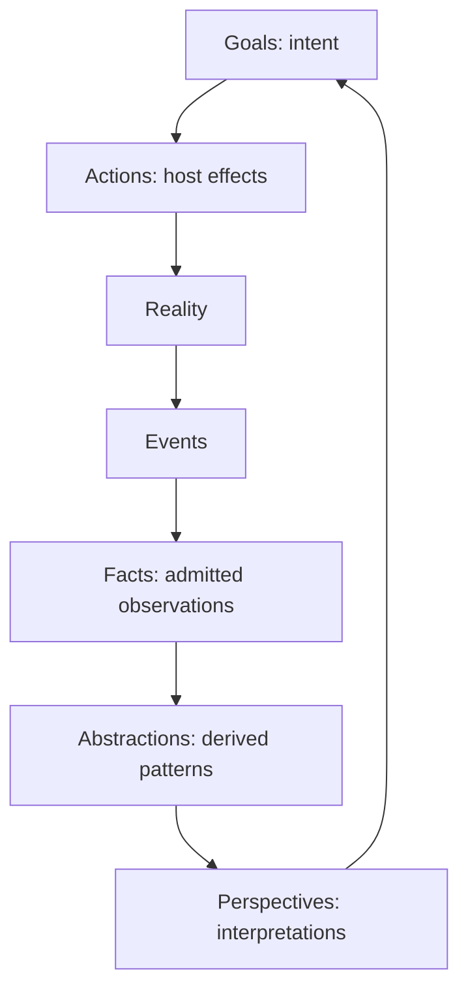
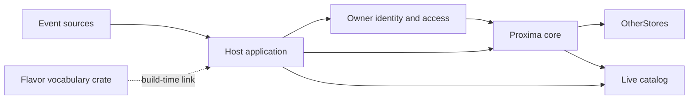

# Proxima
> Status: current

Proxima is an owner-scoped memory substrate for agents. It admits observations
as Facts, derives typed Abstractions and Perspectives, and records Goals as
intent. A host supplies identity, authorization, event sources, and effects;
the core supplies the durable graph and its write rules.

## Start here

| Need | Page |
|---|---|
| Understand the model | [Concepts](concepts.md) |
| Run a local server | [Get started](get-started.md) |
| Connect a host application | [Host integration](host-integration.md) |
| Build a vocabulary crate | [Build a flavor](build-a-flavor.md) |
| Operate a deployment | [Operate](operate.md) |
| Find the one settings table | [Configuration](configuration.md) |
| Review deletion and export | [Data and erasure](data-and-erasure.md) |
| Change the principles or migrations | [Contributing](contributing.md) |

## The Spinning Wheel

Reality is observed through an event source. The host admits the resulting
observation as a Fact. Operators may derive upward into an Abstraction or
Perspective, and a Goal gives the work a desired direction. Actions affect the
host's world; later events close the loop.

The loop is a model of information flow. It does not make Reality, Self, or
an Action a storage-layer memory kind. Goal intent and host scheduling remain
separate concerns; [host integration](host-integration.md)
defines the execution boundary.

## Runtime architecture

A flavor is a vocabulary crate linked into a host at build time. The host reads
remote stores through `OtherStores`; a flavor is not a separately installed
runtime process. MCP and REST expose views of the same live catalog. Discover
the current actions and resources from `tools/list`, `proxima://tools`, or
`/v1/openapi.json`; this site does not copy their schemas.

## Authority

The kernel states the principles. Rust code and tests define observable
behaviour. When a principle changes, change the kernel first and then bring
code, tests, and prose into agreement. Migrations own table shape; rustdoc
owns types, defaults, and limits; [Configuration](configuration.md) owns
settings descriptions.

The [Lean principles](https://github.com/Aquilo-Solution-S/Proxima/blob/main/docs/lean/Causa/Principles.lean)
state the domainless rules. This site presents their current concepts and
decisions; Rust code and tests define runtime behaviour.
